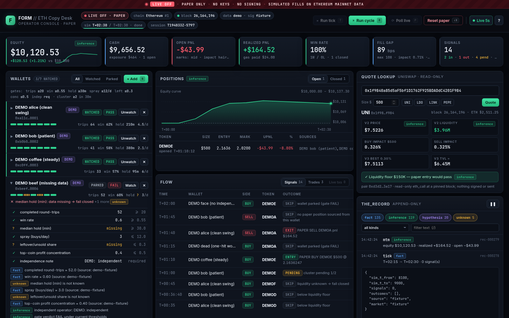

# FORM · ETH Copy Desk (MVP, PAPER ONLY)

> ## ⚠️ NO LIVE TRADING
> This build **cannot trade**. There is no private-key handling, no signer, no transaction
> builder and no order routing anywhere in the code, and no web3/signing library in
> `requirements.txt` (chain access is read-only JSON-RPC over `httpx`; `app/rpc.py` refuses any
> method outside a read allow-list, e.g. `eth_sendRawTransaction` / `eth_sign`). `LIVE_ENABLED=false` is enforced: if it is set truthy the app **refuses
> to start** (`LiveTradingForbidden`), and the paper engine re-checks it on every tick.
> All fills, prices, P&L and the demo wallets/tokens are **simulated / fake**. Nothing here is advice.

## What it is
A Trencher-style **copy-trade desk for Ethereum mainnet**, paper-only. It watches a list of
wallets, admits only wallets that pass strict, fail-closed quality gates, waits for a **cluster**
(≥2 passing wallets buying the same token inside a window), checks a **liquidity floor**, then
simulates a fill with **lag + price-impact + gas haircuts**. Every step is written to an
append-only `the_record` JSONL log, and every claim carries a FORM layer:
`fact | inference | hypothesis | unknown`.

Demo mode (default) runs fully offline on a fixture tape, so the dashboard works with no RPC key.
With an `ETH_RPC_URL` set, the desk can read **real Uniswap pools on Ethereum mainnet** (read-only)
for the liquidity floor, fill price and price impact, and `GET /api/quote/{token}` quotes any token.
With `SIGNAL_SOURCE=live` it also turns **real Uniswap V2/V3 buys/sells by your watched wallets** into
paper-engine signals (decoded from mainnet tx receipts; see §5). Still paper only — nothing is signed.

## Run
```bash
cd /workspace/form-eth-copy
python3 -m venv .venv && . .venv/bin/activate
pip install -r requirements.txt
cp .env.example .env            # optional; defaults == demo mode, LIVE_ENABLED=false
uvicorn app.main:app --host 127.0.0.1 --port 8787
# open http://127.0.0.1:8787/   (API docs: /docs)
```
Then click **Run paper tick** (advances the sim clock 15 min) or **Run full demo cycle**.
**Reset paper** clears positions/trades/clock but never the_record.

Tests: `pip install pytest && python -m pytest -q tests/` (temp DB; never touches `data/`).
Offline tests use a fake chain (`tests/fakechain.py`, `tests/fakelive.py` for receipts/logs/blocks).
`test_live_quote` and `test_live_wallet_scan` run **only** when `ETH_RPC_URL` is set (env or `.env`);
otherwise they are skipped (`LIVE_TEST_WALLET=0x…` picks the wallet for the live scan).
`python tests/test_smoke.py` still works without pytest.

## Dashboard (operator console)


`http://127.0.0.1:8787/` serves a vanilla HTML/CSS/JS console (`app/static/`, no build step, no JS deps;
Inter/JetBrains Mono load from Google Fonts with system fallbacks). A red **LIVE OFF · PAPER ONLY** strip is pinned to the top at all times.
- **Header**: LIVE OFF chip, chain, latest block (RPC probe), data/signal mode, sim clock or live-feed cursor, session id.
  Actions: **Run tick** `T`, **Run cycle** `R` (whole tape / one live poll+process), **Poll live** `P` (enabled only with
  `SIGNAL_SOURCE=live`), **Reset paper** `Shift+X` (confirm; the_record kept), auto-refresh toggle `A` (5 s), help `?`.
- **KPI strip**: equity (+ sparkline), cash/exposure, open PnL, realized PnL, win rate, **fill gap** (avg adverse bps of our
  simulated fill vs the copied wallet's price), signal outcome counts.
- **Wallets**: watched/parked with per-gate pips, first failing reason, expandable checks + layered claims; Watch/Unwatch/Remove.
  **+ Add** `N` opens a form with a live, non-persisted gate preview (`POST /api/gates/preview`).
- **Positions**: equity curve (current paper run, from `mtm` records) + open/closed tables. **Flow**: processed signals with
  outcome, paper fills with gap/impact, decoded live txs (live mode).
- **Quote lookup** `Q`: paste a token address → `/api/quote` (V2 price/liquidity/impact, V3 best pool, floor pass/fail).
- **the_record**: layer filter chips (`1`–`4`), kind filter, text search `/`, pause, click a row for the raw JSON.

Refresh: the page polls every 5 s (toggle `A`, force `G`); after editing `app/static/*` just reload the browser
(assets are served straight from disk; bump `?v=` in `index.html` if a browser caches hard).

## Real mainnet reads (RPC + Uniswap), still paper only
### 1. Get a free RPC URL (never commit it)
- **Alchemy**: sign up at alchemy.com → *Create app* → chain *Ethereum*, network *Mainnet* → copy the
  HTTPS URL `https://eth-mainnet.g.alchemy.com/v2/<KEY>`.
- **Infura**: infura.io → *Create API key* → copy `https://mainnet.infura.io/v3/<PROJECT_ID>`.
- **Public, no key** (fine for a smoke test, rate-limited, may 429/fail at any time):
  `https://ethereum-rpc.publicnode.com`. Note: publicnode refuses `eth_getLogs` without a contract
  address, so `/api/swaps` needs Alchemy/Infura (or a node that allows topic-only log filters).

Put it in **`.env`** (gitignored), never in `.env.example`, code, or a commit:
```bash
cp .env.example .env
sed -i 's#^ETH_RPC_URL=.*#ETH_RPC_URL=https://eth-mainnet.g.alchemy.com/v2/<YOUR_KEY>#' .env
```
The URL is redacted to
`scheme://host/***` in `/api/config`, and RPC error messages never include it. `RPC_URL` is still
accepted as a legacy alias. Every client verifies `eth_chainId == 1` before its first read; any other
chain makes every read fail closed.

### 2. Pick a data mode
| `DATA_MODE` | Signals | Liquidity floor / price / impact |
|---|---|---|
| `demo` (default) | tape (`SIGNAL_FIXTURE`) — always, even with `SIGNAL_SOURCE=live` | fixture numbers; no RPC used by the engine |
| `hybrid` | tape, or **live wallet swaps** with `SIGNAL_SOURCE=live` | fixture numbers for tape tokens that have a `price_path`; **live Uniswap V2** for every other token address |
| `rpc` | tape, or **live wallet swaps** with `SIGNAL_SOURCE=live` | **live Uniswap V2 for every token**; the default demo tape's synthetic tokens therefore all fail closed |

`rpc`/`hybrid` **without** `ETH_RPC_URL` degrades to `demo` (health shows `effective_data_mode`, and a
`data_mode_fallback` record with layer `unknown` is written). `/api/quote` and `/api/swaps` work in
any mode as long as `ETH_RPC_URL` is set.

To watch the engine use live pools, run the real-token tape (synthetic wallets/times, real tokens):
```bash
DATA_MODE=hybrid SIGNAL_FIXTURE=data/fixture_signals_live.json DB_PATH=data/live.db \
  uvicorn app.main:app --host 127.0.0.1 --port 8787
```
Observed (block 26158958, public RPC): UNI cluster → paper BUY at the live V2 mid $7.3477 with
0.93% impact (0.33% curve+fee + 0.6% buffer); LDO skipped, $20.5k V2 liquidity < $150k floor;
`0x1111…1111` skipped `liquidity unknown -> fail closed` (layer `unknown`, cause `no Uniswap V2 WETH
pair for token`); PEPE cluster → BUY; alice sells UNI → mirror exit −$25.17 (haircuts + gas only,
because live prices are "now", not historical).

### 3. What is read, and how (all `eth_call` at one pinned block per quote)
**Uniswap V2 (authoritative for the paper gate)** — `app/uniswap.py`
1. `factory.getPair(token, WETH)`; zero address ⇒ `QuoteUnavailable` (404, layer `unknown`).
2. `pair.getReserves()` + `pair.token0()`; zero reserves ⇒ unknown. `token.decimals()` must exist and be ≤ 36.
3. `price_eth = reserveWETH / reserveToken` (decimal-adjusted), `price_usd = price_eth × ETH/USD`.
4. `liquidity_usd = 2 × WETH reserve × ETH/USD` (standard V2 TVL; assumes the pool is balanced, which V2 always is at mid).
5. Impact = exact `getAmountOut` on the constant-product curve incl. the 0.3% LP fee, for the trade size.
   In the paper engine, live fills use `curve impact + IMPACT_PCT` (the buffer stands in for latency/MEV).
6. WETH itself is quoted against the USDC/WETH pair.

**ETH/USD** = mean of the V2 USDC/WETH and WETH/USDT mid prices. If they differ by more than
`STABLE_MAX_DEV_PCT` (default 2%) or ETH/USD is outside $50–$100k, every quote fails closed
(depeg / manipulated pool guard).

**Uniswap V3 (best-effort, informational in `/api/quote`; not used by the gate)**:
`V3Factory.getPool(token, WETH, fee)` for fees 500/3000/10000/100 → `slot0()` (sqrtPriceX96 → price),
`liquidity()` (in-range L), pool balances (`TVL ≈ 2 × WETH balance × ETH/USD`, so dead pools with absurd
slot0 prices don't look huge); best pool = highest TVL; size impact via `QuoterV2.quoteExactInputSingle`
(dry-run `eth_call`). A V3 failure never blocks the V2 answer.

Addresses used (Ethereum mainnet, lowercase, also returned in every quote under `addresses`):
| Name | Address |
|---|---|
| WETH | `0xc02aaa39b223fe8d0a0e5c4f27ead9083c756cc2` |
| USDC | `0xa0b86991c6218b36c1d19d4a2e9eb0ce3606eb48` |
| USDT | `0xdac17f958d2ee523a2206206994597c13d831ec7` |
| Uniswap V2 Factory | `0x5c69bee701ef814a2b6a3edd4b1652cb9cc5aa6f` |
| V2 USDC/WETH pair | `0xb4e16d0168e52d35cacd2c6185b44281ec28c9dc` |
| V2 WETH/USDT pair | `0x0d4a11d5eeaac28ec3f61d100daf4d40471f1852` |
| Uniswap V3 Factory | `0x1f98431c8ad98523631ae4a59f267346ea31f984` |
| Uniswap V3 QuoterV2 | `0x61ffe014ba17989e743c5f6cb21bf9697530b21e` |

Function selectors are hard-coded in `app/uniswap.py` (verified as keccak256 of the signatures).
Snapshots are cached `QUOTE_CACHE_S` (15 s) per token; a V2 quote costs ~6–8 RPC calls, the V3
section ~20 more (pass `?v3=false` to skip it).

### 4. Smoke-test a quote
```bash
curl -s 127.0.0.1:8787/api/quote/0xA0b86991c6218b36c1d19D4a2e9Eb0cE3606eB48 | jq '.v2.price_usd, .v2.liquidity_usd'
curl -s '127.0.0.1:8787/api/quote/0x1f9840a85d5aF5bf1D1762F925BDADdC4201F984?size_usd=2000&v3=false' | jq .v2
curl -s '127.0.0.1:8787/api/swaps/<wallet>?blocks=1000&limit=20'   # needs Alchemy/Infura-class RPC
```
No RPC configured ⇒ `503 {"layer":"unknown"}`. No V2 WETH pair ⇒ `404 {"layer":"unknown","reason":"no Uniswap V2 WETH pair for token","paper_entry":"would be refused (fail closed)"}`.
RPC/network error ⇒ `502`.

### 5. Live wallet-swap signals (`SIGNAL_SOURCE=live`)
```bash
# .env (gitignored): ETH_RPC_URL=https://eth-mainnet.g.alchemy.com/v2/<YOUR_KEY>
DATA_MODE=hybrid SIGNAL_SOURCE=live DB_PATH=data/live.db \
  uvicorn app.main:app --host 127.0.0.1 --port 8787
# add a REAL wallet you want to copy (stats must pass the gates, or it stays parked and is not scanned):
curl -s -XPOST 127.0.0.1:8787/api/wallets -H 'content-type: application/json' -d '{"address":"0x…","label":"trader1",
  "independence_note":"own funding source, checked on etherscan","watch":true,
  "stats":{"round_trips":40,"win_rate":0.6,"median_hold_min":90,"buys_per_day":4,"leftover_pct":0.1,"top_coin_profit_share":0.3,"source":"manual"}}'
curl -s -XPOST 127.0.0.1:8787/api/paper/tick | jq .poll        # poll chain + run engine (or wait SIGNAL_POLL_SECONDS)
curl -s '127.0.0.1:8787/api/signals/live?status=signal' | jq    # decoded signals (dedup table)
curl -s 127.0.0.1:8787/api/health | jq .live_signals            # cursor, scan mode, counts, last poll, 429s
curl -s '127.0.0.1:8787/api/signals/scan/0x…?blocks=300' | jq   # ad-hoc read-only scan of ANY wallet (not persisted)
python -m app.live_signals 0x… 300                              # same from the CLI (needs ETH_RPC_URL)
```
Effective only when `ETH_RPC_URL` is set **and** `DATA_MODE` is `rpc|hybrid` (live signals reference real
tokens, which only a live market can price). Otherwise the fixture tape is used and a
`signal_source_fallback` record (layer `unknown`) is written. Demo/fixture behaviour is unchanged.
Use a separate `DB_PATH`: the live clock is unix time, the tape clock is seconds-from-start.

**Which wallets:** every `watched` wallet **plus** any wallet that sourced a still-open paper position
(its sells must close us out even if it was parked since). The seed wallets are synthetic and never trade.

**Per poll** (`app/live_signals.py`; background every `SIGNAL_POLL_SECONDS`, or on each paper tick):
1. Range = (persisted cursor, head − `SIGNAL_CONFIRMATIONS`], capped at `SIGNAL_MAX_BLOCKS_PER_POLL`
   (logs) / `SIGNAL_BLOCKSCAN_MAX` (blocks). The first poll starts `SIGNAL_LOOKBACK_BLOCKS` back.
2. Candidate txs — `SIGNAL_SCAN`:
   * `logs`: ERC-20 `Transfer` logs **from** any watched wallet and **to** any watched wallet (wallets OR-ed
     in the topic, no contract address) → 2 `eth_getLogs` per `LOGS_CHUNK_BLOCKS` chunk regardless of wallet count.
     Needs Alchemy/Infura (public nodes refuse topic-only filters).
   * `blocks`: `eth_getBlockByNumber(n, true)`, keep txs whose `from` is watched. Works on any node.
   * `auto` (default): `logs`, switching to `blocks` for the process if the node refuses (`live_scan_mode` record).
3. Each new tx hash (dedup table `live_txs`, PK = tx hash) → `eth_getTransactionReceipt` (+ `eth_getTransactionByHash`
   for `msg.value`) → decode (below). Receipts per poll are capped at `SIGNAL_MAX_RECEIPTS_PER_POLL` (whole blocks).
4. `signal` → `live_txs` + the_record **`live_signal`** (`fact`; `size_usd`/`price_usd` are inference at current
   ETH/USD). Ambiguous Uniswap tx → **`live_signal_rejected`** (`unknown`). Tx with no canonical Uniswap swap
   → `ignored` (stored for dedup only). Any RPC error → **`live_scan_error`** (`unknown`) and the cursor is
   **not** advanced (the next poll retries; dedup makes the retry safe).
5. The engine then processes new signals exactly like tape signals (gate → liquidity floor → cluster →
   lag/impact fill → the_record). The clock jumps to the scanned head block's timestamp. Live **buys** older
   than `SIGNAL_MAX_AGE_S` at processing are skipped (`stale live signal`); sells are never gated.
   Idle polls (no new signals) write nothing to the_record.

**Decoding, fail closed** — emitted only if it is clearly ONE buy or ONE sell of ONE token:
* receipt `status == 1` and receipt `from` is a watched wallet (the wallet sent the tx);
* ≥1 V2 `Swap` (`0xd78ad95f…`) / V3 `Swap` (`0xc42079f9…`) from a pool whose `factory()` is the canonical
  Uniswap V2 (`0x5c69…aa6f`) / V3 (`0x1f98…f984`) factory — look-alike pools (Sushi, forks, fake emitters) don't count;
* wallet net ERC-20 deltas from `Transfer` logs; base assets = WETH, USDC, USDT, DAI, native ETH.
  **buy** = exactly one non-base token in, none out, wallet paid a base asset (Transfer out, or `msg.value`
  net of WETH refunds). **sell** = exactly one non-base token out, none in, base proceeds observed:
  a base Transfer **in**, or — **router-hop sell to native ETH** — a WETH `Withdrawal` in the tx (the
  router unwraps and pays ETH via an internal call that leaves no log; proceeds are inferred from the
  Withdrawal amount);
* the token must be token0/token1 of a verified Uniswap pool swapped in the same tx.
* Rejected: token-for-token, multi-token batches, two different base assets, no payment / no proceeds
  seen for the wallet, token not in a Uniswap pool of the tx, tx not sent by the wallet, malformed data.

Signal shape fed to the engine (same keys as the tape + extras):
`{id: "tx-<hash>", t: <block unix ts>, wallet, token, side, size_usd?, price_usd?, symbol?, tx, block, venues, base_asset, base_amount_raw, token_amount_raw, size_method, source: "live"}`.

**RPC budget / rate limiting**: `RPC_MAX_RPS` (default 5) spaces *all* client calls; HTTP 429 is retried
twice with backoff (count in health `rpc_throttled_429`). Per poll: logs mode ≈ 2 `eth_getLogs` per chunk + 1
`eth_getBlockByNumber` + 2 calls per candidate tx + 3 `eth_call` per never-seen pool + token meta;
blocks mode adds one full-block call per block (≈150–300 KB each), hence `SIGNAL_BLOCKSCAN_MAX=20`.

**Measured on real mainnet (public node, block scan, 2026-10-09 ~21:55 CT):** of 26 txs sent to the Uniswap
routers in 10 consecutive blocks, 17 decoded to signals (9 router-hop sells to native ETH, 5 ETH buys,
2 sells to WETH, 1 USDT buy), 8 were **Uniswap V4** swaps (ignored, see gaps), 1 was rejected (a V4 sell hop
then a V3 WETH→USDT leg: the sold token was not in a V2/V3 pool). Ad-hoc scan of a real wallet
(`0x8bb8…0afe`, 11 blocks, 24 RPC calls): one RLC buy for 25.90 USDT (V2+V3 hop) + that V4 rejection.

## What the demo shows (fixture tape, 14 signals, 0–9000 s)
| Signal | What happens | Layer |
|---|---|---|
| alice buys DEMOA | cluster pending 1/2, no entry | hypothesis |
| cafe buys DEMOC | skipped: cafe parked (spray, short hold, leftovers) | inference |
| bob buys DEMOA | cluster 2/2 → **paper BUY** with lag+impact | inference |
| alice/bob buy DEMOD | skipped: $40k liquidity < $150k floor | inference |
| alice buys DEMOF | skipped: liquidity unknown → fail closed | unknown |
| bob + coffee buy DEMOE | cluster → **paper BUY**, stays open (marked to market) | inference |
| alice sells DEMOA | **mirror exit** → realized ≈ +$164 after haircuts + gas | inference |
| dead / face buy | skipped: parked (concentration + too few trips / no independence note) | inference |

Seed wallets (`data/seed_wallets.json`) are **synthetic vanity addresses** (`0xa11ce…`, `0xb0b0…`) —
not real traders. `beef` has missing stats to show fail-closed behaviour.

## FORM mapping
| FORM principle | Where |
|---|---|
| Live dark | `app/config.py` `assert_live_dark` (startup + every tick); no signer exists; UI banner "LIVE OFF" |
| Strict wallet gates, fail closed | `app/gates.py` — round-trips, win rate, median hold, spray (buys/day), leftover/unsold cap, top-coin profit concentration, independence note. Missing input ⇒ FAIL + `unknown` claim. Only PASS wallets can be `watched`; others are `parked` (PATCH to watched on a FAIL returns 409). |
| Liquidity floor | `app/paper.py::_buy` — `LIQUIDITY_FLOOR_USD`; unknown liquidity fails closed. In `rpc`/`hybrid` the number is the live V2 pool (`app/market.py::LiveMarket`), logged as a `pool_read` (`fact`) record; a missing pair / RPC error / bad data ⇒ `skip` with layer `unknown` and a `cause` |
| Lag + impact haircut | `app/paper.py::_fill` — fixture: mid `LAG_MS` after the signal ± (`IMPACT_PCT` + size/liquidity %); live: latest-block V2 mid ± (exact V2 curve cost + `IMPACT_PCT`). Plus `PAPER_GAS_USD` per side; marks use mid − impact. A live exit whose price can't be read is deferred (`unknown`), never invented |
| the_record | `app/record.py` — append-only JSONL `{id, session, t_event, kind, layer, content}` at `data/the_record.jsonl`; only opened with mode `"a"` |
| Layer labels | records, gate `claims`, portfolio (`layer: inference`), UI badges + layer filter |
| Cluster rule | `app/paper.py::_buy` — ≥`CLUSTER_MIN_WALLETS` distinct passing watched wallets within `CLUSTER_WINDOW_S`. `CLUSTER_REQUIRED=false` allows solo entries at `SOLO_SIZE_FRACTION` size, logged as `hypothesis` |
| Exits | mirror exit when a source wallet sells — never gated (reducing risk is always allowed) |

Layer convention: **fact** = an observed input as the source reported it (in demo, the fixture);
**inference** = a verdict/simulation derived from facts + rules; **hypothesis** = forward-looking
(e.g. "edge persists", "cluster forming"); **unknown** = required data missing.

## Layout
```
app/config.py    settings + live guard        app/gates.py    wallet scoring
app/record.py    the_record JSONL             app/paper.py    paper engine / portfolio
app/store.py     SQLite (wallets, positions, trades, signals_seen, state, live_txs)
app/signals.py   DemoSource (fixtures), rpc_probe (read-only); RpcSource = alias of live_signals.LiveSource
app/rpc.py       read-only JSON-RPC client (chainId==1 check, get_block_number, eth_call, get_logs, ABI helpers)
app/uniswap.py   V2 pair/reserves/price/liquidity/impact, ETH/USD, V3 slot0/TVL/QuoterV2
app/market.py    FixtureMarket / LiveMarket (what the paper engine asks for prices/liquidity/impact)
app/swaps.py     "last N swaps" for a wallet via eth_getLogs (read-only smoke route)
app/live_signals.py  live watched-wallet swap scanner/decoder + LiveSource (SIGNAL_SOURCE=live)
app/main.py      FastAPI routes               app/static/     dashboard (HTML/JS/CSS)
data/            seed_wallets.json, fixture_signals.json, fixture_signals_live.json (real tokens),
                 form.db, the_record.jsonl
tests/           test_smoke.py (demo cycle), test_uniswap.py (offline fake chain + gated live), fakechain.py,
                 test_live_signals.py (decoder/scanner/engine on fake receipts + gated live scan), fakelive.py
```

## API
`GET /api/health` · `GET /api/config` (RPC redacted) ·
`GET|POST /api/wallets` · `GET|PATCH|DELETE /api/wallets/{addr}` · `GET /api/wallets/{addr}/gate` ·
`GET /api/portfolio` · `GET /api/trades` · `GET /api/stats` (dashboard KPIs + equity series) ·
`GET /api/signals/recent?limit=` (processed signals + outcome) · `POST /api/gates/preview` (score stats, not saved) · `GET /api/records?limit=&kind=&layer=` ·
`POST /api/paper/tick` · `POST /api/paper/run` · `POST /api/paper/reset` ·
`GET /api/quote/{token}?size_usd=&v3=` (live Uniswap price/liquidity/impact) ·
`GET /api/swaps/{wallet}?blocks=&limit=` (last N Uniswap V2/V3 swaps where wallet is the recipient) ·
`GET /api/signals/live?status=&limit=` (decoded live txs) · `POST /api/signals/poll` (scan only, live mode) ·
`GET /api/signals/scan/{wallet}?blocks=` (ad-hoc read-only decode of any wallet).
Background loop: `AUTO_TICK_SECONDS>0` (tape) or `SIGNAL_POLL_SECONDS>0` (live; runs in a worker thread).

## Known gaps / next steps
1. **Live signal misses (by design, fail closed).** Not emitted: **Uniswap V4** swaps (PoolManager
   singleton, Swap topic `0x40e9cecb…`; ~1/3 of Universal Router txs in our 10-block sample) and any
   route with a V4 hop; other DEXes/aggregator-internal pools (Sushi, Curve, Balancer, 1inch/0x RFQ, CoW);
   txs not sent by the wallet itself (Safe / ERC-4337 smart accounts, relayers, intent fills) — rejected;
   sells whose proceeds go to another address; token-for-token rotations (rejected rather than split into
   sell+buy). Router-hop sells to native ETH **are** caught via the WETH `Withdrawal` (amount inferred).
   Reorgs: only `SIGNAL_CONFIRMATIONS` deep (default 2); a deeper reorg could leave a stale signal (no
   un-emit). `size_usd`/`price_usd` use *current* ETH/USD, not the price at the tx block. Wallets added
   after the cursor moved are only scanned from the cursor onward (no backfill). `blocks` mode only sees
   txs where `from` == wallet. The paper fill/liquidity gate is still V2-only (gap 3), so a V3-only token
   bought by a watched wallet is detected but its paper entry fails closed.
2. **Live prices are "now".** A tape signal at sim time t is filled at the latest-block mid, so the
   lag haircut is not modelled for live tokens (`lag_drift_pct` is null) and the live tape's P&L is just
   haircuts + gas. Historical pricing needs an archive node (`eth_call` at the signal's block).
3. **V2 only for the gate.** Tokens whose liquidity lives only on V3/V4 (or Sushi, Curve, Balancer)
   fail closed. V3 is read in `/api/quote` (slot0 + TVL + QuoterV2) but V3 TVL is an approximation
   (quote-side balance, includes out-of-range liquidity); Uniswap V4 (singleton PoolManager) is not read.
4. **ETH/USD** comes from two V2 stable pairs (with a 2% cross-check), not Chainlink; fine for a paper
   gate, not for anything with money behind it. V2 spot is manipulable within a block — the pinned
   block + cache is not a TWAP.
5. Real wallet discovery + stats (FIFO round-trips, win rate, hold time, funding-source independence)
   are still hand/fixture entered and labelled with `source`.
6. Token safety checks not implemented (honeypot/fee-on-transfer/tax/ownership, e.g. GoPlus) — a
   fee-on-transfer token's V2 impact is understated. No stop-loss/time exits, no per-token caps beyond
   cash, no auth on the API (bind to 127.0.0.1 only).
7. Going live is **out of scope** and would need a separate, reviewed design (hardware/remote
   signer, simulation via `eth_call`, MEV-protected submission, kill switch). Do not bolt it on here.
